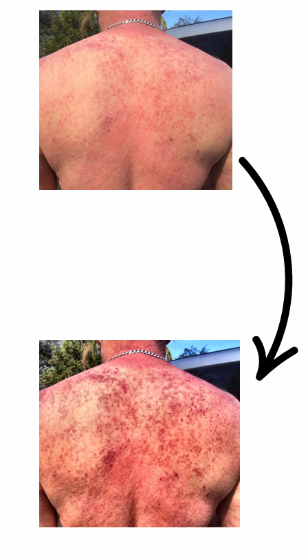
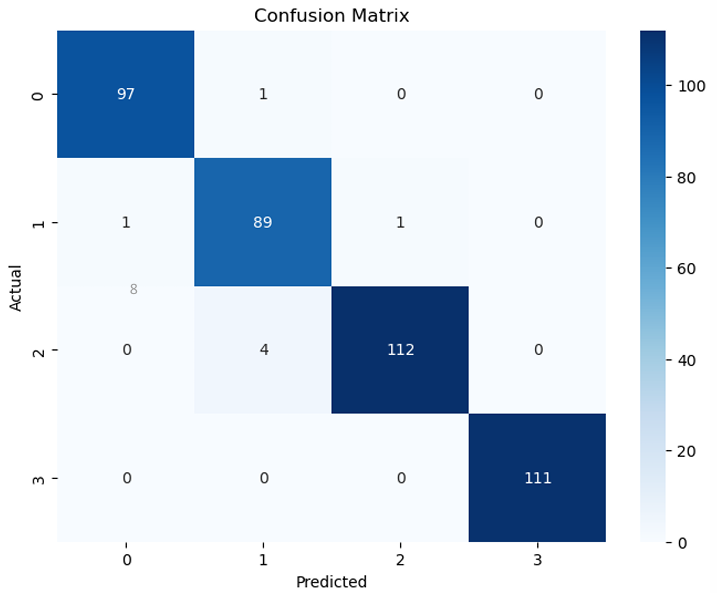

# Skin Disease Detection and Assistance System

## 1. Project Overview

The Skin Disease Detection and Assistance System is an AI-powered pre-screening tool, the project was the final school deliverable after my 1st year 3rd quarter. A user uploads a photo of a skin problem and answers a short questionnaire. Within about 63 seconds, the system predicts the likely skin condition, estimates how severe it is, and recommends whether a doctor's visit is urgent, recommended, or necessary.

It is designed to be embedded in the website of a private dermatology clinic or individual dermatologist. After the prediction, the user is redirected to an information page about the predicted condition.

## 2. Business Context

### 2.1 The problem
Access to dermatological care is slow and unevenly distributed. The Business Understanding report identifies two connected problems:

1. **Limited access to diagnosis.** Many people cannot identify their skin condition. They also lack the money, time, or access for frequent consultations, particularly for conditions such as eczema, psoriasis, and skin cancer.

2. **No scalable first-contact solution.** Existing AI models usually target specific diseases rather than offering broader diagnostic support. Many people stay undiagnosed or misdiagnosed, which delays treatment.

### 2.2 How this project differs from existing tools
Existing tools mostly predict a disease. This project adds three things:

1. Fast pre-screening of skin conditions.
2. Medically reviewed educational content tailored to the user's symptoms.
3. An interface that prioritizes users by the urgency of their case.

More accurate competitors may exist. The project's value lies in **user engagement, patient education, and relieving dermatologists' workflow**, not in beating them on accuracy.

##### Example how the program enhances pictures of skin diseases.

## 3. What Was Built

### 3.1 User flow (about 63 seconds end to end)

1. The user takes a photo, crops it, and answers the questionnaire.
2. The model predicts the condition and saves the information.
3. The system shows the user the result with an explanation.

### 3.2 Components

| Component | Description |
|---|---|
| **Image classifier** | DenseNet with transfer learning; currently classifies **four** skin-disease classes |
| **Image preprocessing** | Automatically adjusts the lighting of the input image for better analysis |
| **Explainability** | Grad-CAM heatmaps show which image regions drove each prediction |
| **Questionnaire and severity logic** | Decision-tree-style questions starting with *"Is the infection spreading?"*: **Yes** → a doctor's visit is necessary; **No** → a visit is recommended but not urgent |
| **Severity inputs** | Duration, area size, whether the area is changing, look of the infected area, pain, immune-system status, possible condition |
| **Data storage** | Each case is saved as a row with a random `User_id`, the questionnaire answers, the predicted condition, and a level of severity. Images are not saved. |

---

## 4. Results

### 4.1 Model performance (held-out test data)

| Metric | Result |
|---|---|
| Accuracy | **98%** |
| F1 score | **98%** |

The confusion matrix covers 416 test images. Of these, 409 were classified correctly (about 98.3%). Class 2 was the weakest, with 4 images predicted as class 1; class 3 was classified perfectly (111 of 111).

### 4.2 Business-value outcomes

| Outcome | Result |
|---|---|
| Time per user interaction | About 63 seconds |
| Estimated staff-cost saving | About **€23,712 per year**, based on average Dutch dermatologist and medical-assistant salaries and the 5–10 minutes of questioning per appointment |

## 8. Limitations and Next Steps

**Acknowledged in the project:**

1. **Few classes.** Only four conditions are covered. More classes would reduce false positives, because the model cannot say "none of these" for conditions outside its scope.

2. **Dataset not clinically reviewed.** The dataset must be checked by a professional before implementation/deployment.

3. **Limited storage.** The Excel table saves only the typed questionnaire input, not the pictures.

