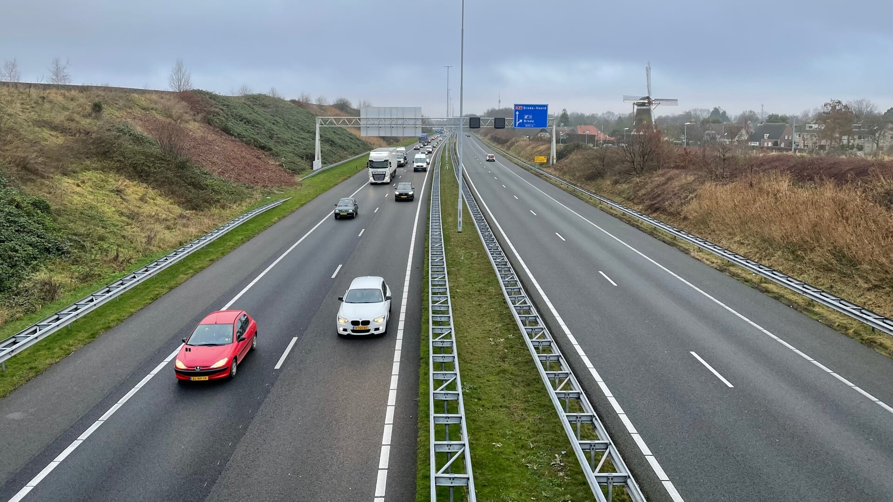
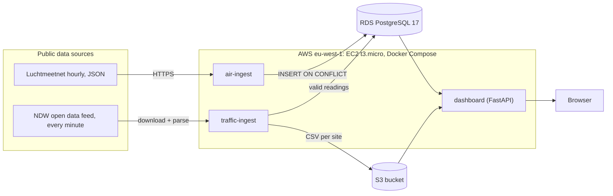

# Project AirBreda 

Project AirBreda collects hourly air quality and traffic data for one motorway interchange in Breda, stores it on AWS, and shows it on a small dashboard with a predicted NO2 value and the risk that NO2 exceeds the EU limit.

##### Picture from bredavandaag.nl  [link](https://www.bredavandaag.nl/algemeen/algemeen/429851/a27-richting-breda-is-dit-weekend-dicht)

It was built as the final deliverable of the one-week **System Design and Cloud Platforms** elective school course.

Nitrogen dioxide (NO2) is one of the most closely monitored air pollutants in Europe because it is both harmful and directly tied to everyday activity. Produced mainly by cars, it irritates the airways, aggravates asthma and other respiratory conditions. Because road traffic is its dominant source in cities, NO2 near busy motorways such as the A27 at Breda is a direct indicator of how traffic affects the health of people living nearby, and measuring it is the first step toward understanding, predicting and eventually reducing that exposure.

## 1. Course context and goal

**Course goal.** The elective focused on three things:

1. The types of databases (relational, key-value, time-series, etc.).
2. How to decide which database fits a given workload.
3. How to make and defend cloud architecture decisions: compute, storage, cost and availability.

**Project goal.** Build a small but realistic end-to-end system on any cloud platform and justify every major choice. The project needed two public data sources, two kinds of storage, a trained model and a user-facing endpoint. At roughly 8,800 NO2 rows a year, scale was never the challenge. The challenge was choosing the right tools for a small workload and showing why.

**Business framing.** A municipality or environmental agency wants a cheap, always-on signal solution. The design therefore prioritises low idle cost, simple operations, reproducibility and scalability.

## 2. What I achieved

| Area | Result |
|---|---|
| **Ingestion** | Two containerised fetchers run hourly. |
| **Storage** | Readings go into **RDS PostgreSQL 17**. Every traffic file is also stored in an **S3 bucket** as `ndw/YYYY-MM-DD/HH-<site>.csv`. |
| **Data quality** | Missing or stuck NO2 values are kept and flagged. These wrong values are kept in the CSV but not written to the database. A `DATA_QUALITY_ERROR` warning is logged per bad reading, and a `BAD_DATA_THRESHOLD_EXCEEDED` error when more than 10 occur in an hour. |
| **Model** | A scikit-learn linear regression predicts NO2 from site traffic and hour of day. A sigmoid function around 40 µg/m³ turns the prediction into a risk score. The model is trained offline. |
| **Containers** | Three images (`Dockerfile`, `Dockerfile.traffic`, `Dockerfile.dashboard`) run together via Docker Compose on one private network. |
| **Testing** | 15 automated tests run with no database, bucket or internet. They cover retries, exit codes, data-quality rules, dashboard routes (including a failing prediction) and model loading. |
| **Documentation** | An Architecture Design Document with diagrams and six Architecture Decision Records (ADRs), plus a database comparison and a requirements trace (`docs/`). |

### Key design decisions

**Database: RDS PostgreSQL.** I compared RDS PostgreSQL, Aurora Serverless v2, DynamoDB and Athena against the actual needs of the data:

- The volume is tiny, so scalability is irrelevant. Idle cost and simplicity matter.

**Two stores, two roles.** The database holds curated, deduplicated readings that can be queried with SQL. The bucket holds the raw history of every parsed traffic file, so traffic can be recomputed later.

**Model served from a baked-in file.** Training happens offline. The model that is served is always the one that was tested, and it cannot change while the system runs.

## 3. Deployed architecture

**How it works.** The two fetchers run once at start-up and then at the start of every hour. NO2 is stored with the timestamp of the **end** of the hourly average. Traffic is stored with the start of the measured minute. The dashboard reads the latest NO2 from the database and the latest traffic for the requested site, runs the model, and returns the real values, the prediction and the risk.

**Security.** The EC2 instance gets its AWS permissions from an IAM role, so no AWS keys are stored on the server. Database credentials live only on the developer's machine.

## 4. What I would improve with more time

**Reliability and operations**
- **Apply Multi-AZ in the infrastructure** after a FinOps cost check, then run a real failover test to prove the 15-minute RTO.

- **Add a restart policy to Compose.** Today the containers do not restart after a server reboot.

- **Move from one EC2 host to a managed container service**. This removes the single server as a point of failure.

