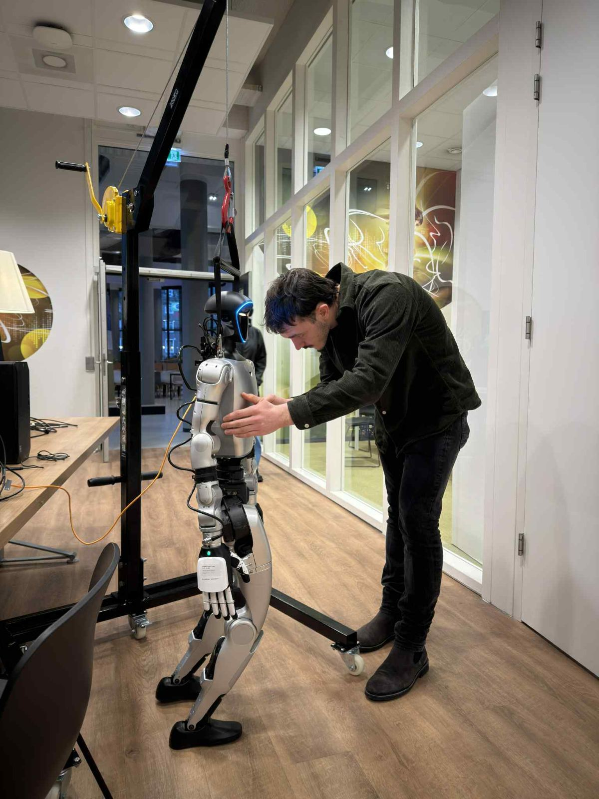
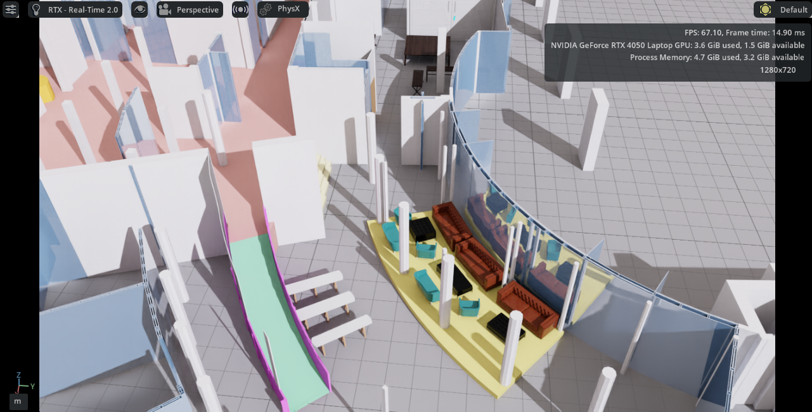

# Unitree Robotics Projects at BUas Robotics

## Overview
Through the BUas Robotics department, I worked on two Unitree platforms during my studies: the **Unitree G1 humanoid** and a **Unitree wheeled quadruped**.

 The work covered the full pipeline from CAD and simulation to real-world deployment. The main lesson is that a robot that works in simulation is not yet a robot that works in a school hallway, and closing that gap safely is most of the engineering effort.

## What I Worked On
| Platform | Focus | Status |
|----------|-------|--------|
| Unitree G1 (humanoid) | Robot communication, control through the Sport API, simulation | Completed |
| Unitree wheeled quadruped | Autonomous point-to-point navigation for school events | In progress (target: 11 January 2027) |

Across both projects I:
- Controlled and communicated with the robots through the **Unitree Sport APIs**.
- Built simulation environments in **NVIDIA Isaac Sim** by converting architectural CAD files into **USD (Universal Scene Description)** files.
- Used **SLAM (Simultaneous Localization and Mapping)** to measure real rooms and turn them into simulation environments.
- Wrote safety programs that stop development code from sending commands that could damage the robot.
- Wrote documentation accoring to the industry standard methods, so future developers within the department can continue work on the robots 

## What I Learned
**Software and communication**
- Working in **Linux** as the daily development environment.
- How **ROS 2 (Robot Operating System 2)** structures nodes, topics, and services.
- How **Nav2** handles localization, path planning, and obstacle avoidance.

**Design and simulation**
- CAD modelling in **FreeCAD**.
- The CAD → USD → Isaac Sim workflow for turning building plans into usable simulation worlds.

##### School building simulation built by me

**Engineering practice**
- Running a robotics project end to end: simulate first, add safety limits, test in a controlled space, then deploy.

- Why safety layers, such as velocity limits, command validation, and emergency stops, must exist before the first real-world test, not after the first failure.

## What I Achieved

- Gained hands-on experience with two different Unitree robot types, one legged and one wheeled.

- Established a safety-first development approach that protects the hardware during testing.

- Moved from using the manufacturer's APIs to building a navigation platform on top of them.

## Current Project: MINDF Robot navigation Platform

**Objective:** Let teachers safely send the wheeled robot from point A to point B during school events, avoiding Dynamic obstacles such as tables, stands, and people.

**In scope**
- Autonomous A-to-B navigation around Dynamic obstacles using Nav2.

- A simple teacher-facing interface for choosing a destination and stopping the robot.

- Safety limits and an emergency stop.

